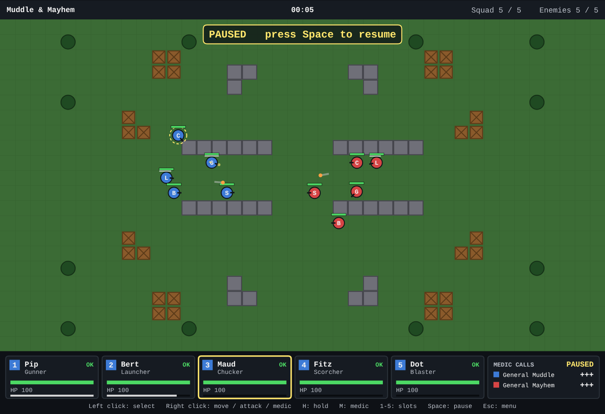

# Muddle & Mayhem

A small real-time squad-tactics game for the browser. Five soldiers per side,
each with a different weapon, directed from above until one squad is wiped
out. Written in plain TypeScript on HTML Canvas with no game engine, built
with Claude Code as a learning project.

**Play it:** https://karlnewell.github.io/muddle-and-mayhem/



## How to play

You are General Muddle (blue, left). The computer is General Mayhem (red,
right). Each side has five soldiers, one per class: Gunner, Launcher,
Chucker, Scorcher, Blaster. Last squad standing wins.

The battle starts **paused** so you can give the first orders. Press Space
to let it run; press Space again whenever you want to think. Orders given
while paused are taken at once and shown as faint markers.

| Input | What it does |
|---|---|
| Left click a blue soldier | Select it (Shift adds to the selection) |
| Keys 1 to 5, or click a HUD card | Select by slot (Shift adds) |
| Right click the ground | Move the selected soldiers there |
| Right click an enemy | Attack it: move into range, fire until it drops, then hold |
| Right click a downed friend | Call the medic (three calls per side, back at half health) |
| H | Hold position and fire at anything in range |
| M | Call the medic for a selected downed soldier |
| Space | Pause and resume |
| Esc | Menu: resume, restart, back to the title |

Walls, crates and trees block movement and straight shots. Grenades and
dynamite go over them. Rockets, flame and dynamite can kill outright; a
killed soldier leaves ash and no medic can help.

Add `?seed=123` to the URL to replay the same battle. The page exposes
`window.__mm` with the seed, tick, command log and state, so a bug report
can carry everything needed to reproduce a battle.

## Run locally

```bash
npm install
npm run dev
```

Open the URL Vite prints (the game lives at `/muddle-and-mayhem/`).

## Test

```bash
npm run check
```

That runs the type check, the simulation arithmetic guard, the unit tests,
and the production build. The browser tests (a smoke test and one that
plays a few seconds of a battle) need a build first:

```bash
npm run build
npm run test:e2e
```

If your Playwright has no browser of its own, point it at one with
`PW_CHROMIUM_PATH=/path/to/chromium`.

To see how the tuning plays out, `npm run measure` runs sixty computer-
versus-computer battles headless and prints battle length, time to first
damage, downs, medic use and the winner split. Pass a JSON object to try
other values without editing the code:

```bash
npm run measure -- '{"MOVE_SPEED":2,"WEAPONS":{"gunner":{"cooldown":12}}}'
```

## Headless simulation

The whole battle runs without a browser. `runBattle` drives it with
controllers and records every command; `replayBattle` rebuilds it from the
seed and that log alone. Same seed plus same log gives the same state, bit
for bit, which is what `tests/sim/replay.test.ts` asserts under `npm test`.
`state.events` holds only the current tick's events and is cleared at the
start of every `step`, so a caller that runs several steps per frame must
drain them after each step:

```ts
import { expect, it } from 'vitest';
import { createAi, hashState, replayBattle, runBattle } from '../../src/sim';

it('replays bit for bit', () => {
  const seed = 42;
  const run = runBattle({ seed, maxTicks: 18000, controllers: [createAi('blue', seed), createAi('red', seed)] });
  const replayed = replayBattle(seed, run.log, run.ticks);
  expect(hashState(replayed)).toBe(hashState(run.state));
});
```

## Code layout

- `src/sim/` the rules: deterministic, headless, no browser, no clock, no `Math.random`.
- `src/game/` the clock, the battle session, the command log, the seed, the debug hook.
- `src/render/` the top-down renderer behind a small `BattleRenderer` interface.
- `src/input/` mouse and keyboard to `Command` objects.
- `src/ui/` the HUD, title, menu and result screens, all drawn on the canvas.
- `src/main.ts` wires them together.

## Repository setup (owner, one time)

These cannot be done from a cloud session.

1. **Pages:** Settings → Pages → Build and deployment → Source → **GitHub Actions**.
   The `deploy` workflow publishes `dist/` on every push to `main`.
2. **Branch protection:** Settings → Branches → add a rule for `main` that
   requires the **`ci`** status check to pass before merging.
3. **Claude on PRs:** install the Claude GitHub App on this repository and add
   a repository secret named `CLAUDE_CODE_OAUTH_TOKEN`. Until then the
   `claude` workflow ships but does nothing. After that, `@claude` in a PR
   or issue comment asks it to review or fix.

## Project rules

See `CLAUDE.md` for the architecture and working rules, `docs/decisions.md`
for the decision log and roadmap, and `docs/superpowers/specs/` for the design.

## Credit and license

Inspired by the squad-tactics genre of the early 1990s. All code, art, and
names are original. Source is MIT licensed; see `LICENSE`.
